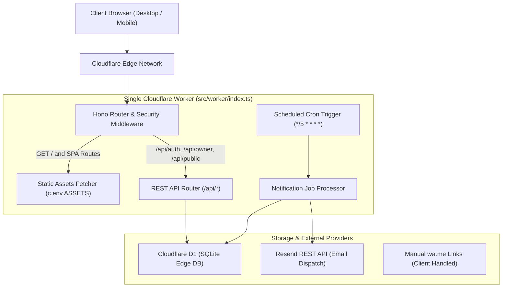
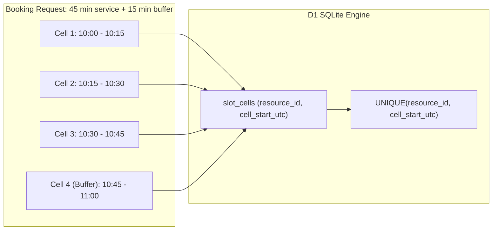
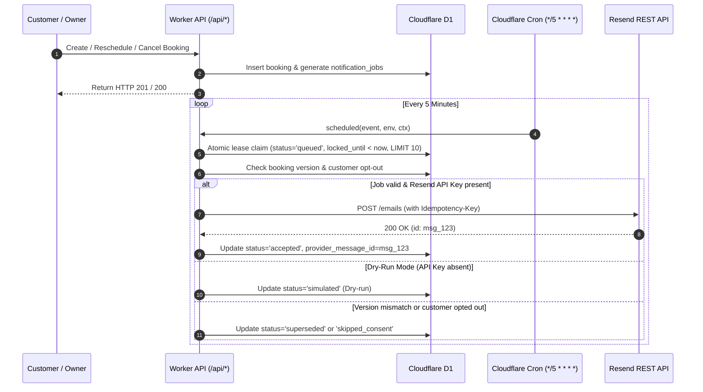

# SlotSync Architecture

## 1. System Topology: The Single-Worker Model

SlotSync adheres to a strict single-worker deployment model on Cloudflare Workers, eliminating operational overhead, multi-service latency, and cross-origin complexity:

### Static Asset Serving
1. When a browser requests static assets (`.js`, `.css`, fonts, images), the Worker's root wildcard handler checks `c.env.ASSETS.fetch(c.req.raw)`.
2. For HTML requests (such as client-side deep links `/app/today` or `/b/:slug`), the static asset fetcher returns `dist/index.html` with single-page application fallback.
3. Typography (`@fontsource/fraunces` and `@fontsource/plus-jakarta-sans`) is bundled locally into `./dist/assets`, guaranteeing zero external font network requests.

---

## 2. Multi-Tenant Data Isolation

SlotSync implements strict tenant boundary enforcement:
- **Session Resolution:** Private routes under `/api/owner/*` are guarded by the `requireAuth` middleware.
- **Tenant Context:** The middleware extracts the `slotsync_session` cookie, hashes the token with SHA-256, and queries the database joining `sessions`, `users`, `memberships`, and `businesses`.
- **Zero Client Trust:** Handlers never accept a `business_id` or `tenant_id` from request parameters or request bodies. All database queries bind the `business_id` resolved directly from the authenticated session context.

---

## 3. Concurrency Safety: Atomic Slot Reservation Engine

To prevent double-bookings under concurrent access (e.g. parallel booking attempts for the same appointment time), SlotSync employs discrete 15-minute intervals in the `slot_cells` table:

### Collision Handling Protocol
1. **Discrete Cells Computation:** An appointment with duration $D$ and buffer $B$ is divided into $(D + B) / 15$ discrete UTC timestamps.
2. **Atomic Batch Commit:** The booking record, slot cells, customer record, and audit events are executed inside a single `c.env.DB.batch(...)` transaction.
3. **Collision Defense:** If two requests attempt to claim any overlapping cell for the same resource, SQLite throws a `UNIQUE constraint failed: slot_cells.resource_id, slot_cells.cell_start_utc` error.
4. **Alternative Slots:** The failing request catches the conflict and immediately executes a localized availability sweep, returning HTTP 409 `SLOT_TAKEN` with up to 3 nearest alternative available times.
5. **Slot Freeing:** When an appointment is cancelled, all associated `slot_cells` rows are deleted atomically, instantly freeing the time window.

---

## 4. Cryptography & Token Design

### Owner Authentication
- Passwords are salted with 32 cryptographically random bytes (`crypto.getRandomValues`).
- Derivation: PBKDF2-SHA256 with 100,000 iterations via WebCrypto (`crypto.subtle.deriveBits`), completing in ~50–100ms within platform CPU limits.
- Stored as `password_salt` and `password_hash` in `users`.

### Customer Manage Tokens (HMAC-SHA256)
- Customer manage URLs require an unguessable token: `/b/:slug/manage/:token`.
- Manage tokens are deterministically derived:
  $$\text{manage\_token} = \text{HMAC-SHA256}(\text{TOKEN\_SECRET}, \text{business\_id} + \text{":"} + \text{booking\_id})$$
- Only the SHA-256 hash of this token (`sha256Hex(manage_token)`) is stored in `bookings.manage_token_hash`.
- On idempotent request replays, the token is re-derived on the fly, eliminating the need to persist plaintext tokens in `idempotency_keys` or logs.
- Incoming manage requests verify `sha256Hex(token) == booking.manage_token_hash`.

### Rate Limiting Privacy
- Rate limits are stored in the `rate_limits` table with `bucket_hash` and `window_start_utc`.
- The bucket hash is computed as:
  $$\text{bucket\_hash} = \text{HMAC-SHA256}(\text{RATE\_LIMIT\_SALT}, \text{action} + \text{":"} + \text{client\_ip})$$
- Raw IP addresses and identifiers are never stored or logged in D1.

---

## 5. Notification & Reminder Engine

The notification pipeline runs asynchronously without external message queues or worker-to-worker RPCs:

### Safety Guarantees
- **Atomic Lease Claims:** Workers claim jobs using `UPDATE notification_jobs SET locked_until = <now + 5m>` with `locked_until IS NULL OR locked_until < now`, preventing duplicate concurrent dispatch across multiple worker instances.
- **Quiet Hours Shift:** Reminder jobs due between 22:00 and 08:00 in the business's timezone are shifted forward to 08:00 the following morning. Transactional notices (confirmations, reschedules, cancellations) are delivered immediately.
- **15-Minute Lateness Boundary:** If cron processing is delayed and an appointment is starting in $< 15$ minutes, stale reminder jobs transition to `skipped_late` rather than alarming the customer after the fact.
- **Provider Honesty:** Successful API responses from Resend indicate provider receipt, not mailbox delivery. The UI and database mark this state strictly as `accepted` ("Accepted by provider, delivery unconfirmed"). Zero "delivered" claims exist in the system.
